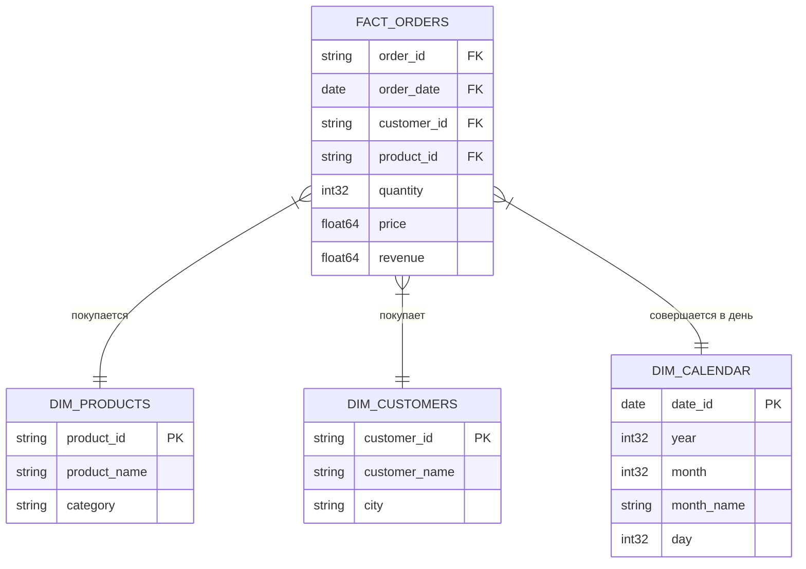

# Паспорт аналитической модели данных (Star Schema)

* **Домен:** E-commerce (Розничные продажи интернет-магазина)
* **Автор:** daddyfromgym2

---

## 1. Зернистость данных (Что означает одна строка)

> **Одна строка таблицы фактов = одна позиция в заказе (конкретный товар × количество × сумма в рамках одного чека).**

---

## 2. Схема данных (Star Schema)

Аналитическая витрина строится по классической схеме «Звезда», где в центре находится таблица фактов продаж, а вокруг неё — таблицы-справочники (измерения).



### Состав схемы:
* **Таблица фактов:** `fact_orders` — содержит метрики продаж и внешние ключи.
* **Измерения (Справочники):**
  * `dim_products` (Товары) — SCD1 (затираем старое при изменении категории).
  * `dim_customers` (Клиенты) — Пока не трогаем (историю изменений городов не отслеживаем).
  * `dim_calendar` (Календарь) — Статический справочник дат для удобной фильтрации по месяцам/кварталам.

---

## 3. Главная метрика и меры

* **Главная метрика:** Общий оборот продаж (`Total Revenue`).
  * **Эталонное число:** `39400.00`
  * **Эталонный SQL-скрипт (из файла sql/canonical_metric.sql):**
    ```sql
    SELECT 
        SUM(revenue) AS canonical_total_revenue 
    FROM fact_orders;
    ```
* **Дополнительные меры:**
  * `quantity` (Количество проданных штук) — Аддитивная мера, можно применять `SUM`.
  * `price` (Цена за штуку) — Неаддитивная мера, `SUM` применять нельзя (только `AVG`, `MIN`, `MAX`).


---

## 4. Бизнес-вопросы для SQL-анализа

1. Какой общий оборот продаж (`revenue`) по каждой категории товаров за весь доступный период?
2. Кто входит в Топ-5 клиентов по объёму выкупленных товаров (`quantity`)?
3. Какова динамика продаж (оборот по месяцам) текущего года?
